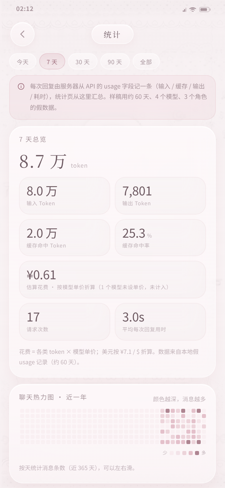

# 缪诗鸳杞

一个面向手机的 AI 陪伴应用（人机恋）。界面是通透的玻璃风格，目前提供粉色蔷薇与冰蓝两套主题。

本仓库是可离线打开的前端样稿：纯 HTML、CSS 与原生 JavaScript，无框架、无外链字体或脚本。聊天、记忆、用量等数据先存在浏览器本地，便于先把交互和界面做完整。后端服务尚未包含在本仓库中。

## 功能

- **首页**：小组件分框摆放，包括在一起天数、时钟、天气、留言、一起听和功能入口（时间胶囊、每日一签、纪念日、一起读等）。
- **聊天**：流式对话界面，支持按提供商分组的模型选择（搜索、收藏、官方图标）、思考深度档位、提示词预设（文风）注入，以及每条回复下的 token 统计。
- **角色与世界**：独立的角色库、用户设定和世界书；支持 SillyTavern 风格的 JSON / PNG 角色卡导入，以及角色、聊天与世界书的绑定。
- **模型与提供商**：自定义 API 提供商（OpenAI 兼容、Anthropic、Gemini、DeepSeek、OpenRouter、中转站等），可配置协议、密钥、模型列表、拉取模型和测试连接。不支持思考的模型不会发送相关参数。
- **提示词预设**：可编辑的提示词片段与采样参数，支持导入酒馆预设，并可预览组装后发给模型的内容。
- **记忆**：可编辑的「此刻」卡片、分类记忆、钉住与软遗忘（可从已遗忘中恢复）。
- **统计**：独立统计页，含时间范围切换、聊天热力图、缓存命中率、花费估算，以及按模型、提供商、角色的排行。
- **一起听**：播放界面与歌单（样稿为演示数据）。
- **我的 / 设置**：主题、壁纸、入口与个人资料。

样稿阶段部分接口（测试连接、余额、真实聊天、用量入库）仍是演示或本地模拟，接上后端后即可换成真实数据。

## 截图

| 模型选择 | 统计 | 思考深度 |
| --- | --- | --- |
|  |  |  |

## 如何打开

构建产物是单文件，可以直接用浏览器打开，不需要服务器，也不需要联网：

```text
dist/index.html
```

桌面浏览器会以手机外框居中显示；窗口宽度不超过 480px 时铺满全屏。也可以起一个本地静态服务：

```bash
cd dist && python3 -m http.server 8080
# 打开 http://127.0.0.1:8080/
```

## 从源码构建

需要 Node.js 18 或更高版本。

```bash
git clone https://github.com/wu352947-cmd/miushi-yuanqi.git
cd miushi-yuanqi
npm run build
```

构建脚本会把样式、脚本和压缩壁纸内联进 `dist/index.html`。

## 目录结构

```text
src/                  源码
  index.html          页面结构
  styles.css          基础样式
  liquid.css          玻璃界面与组件
  data.js             默认数据与结构
  app.js              交互逻辑
  icons/              提供商 / 模型图标（见第三方声明）
assets/wallpapers-720/  构建用壁纸（720px）
scripts/build.mjs     打包为单文件
scripts/prepare_images.py  壁纸压缩
dist/index.html       构建产物，可直接打开
docs/                 设计说明与截图
```

## 设计要点

- 两套主题各自一套色相，壁纸、玻璃、文字与图标同源。
- 移动端性能优先：壁纸按需加载，backdrop-filter 克制，动画只用 transform / opacity。
- API 密钥在样稿中仅存放于浏览器本地，界面始终掩码；导出提供商配置时默认不包含密钥。正式版本应将密钥放在服务端，由后端转发请求。
- 模型官方图标来自 [Lobe Icons](https://github.com/lobehub/lobe-icons)（MIT），只内联实际用到的文件。详见 [THIRD_PARTY_NOTICES.md](THIRD_PARTY_NOTICES.md)。
- 提供商协议、思考参数映射、错误分类和用量统计口径见 [docs/PROVIDERS.md](docs/PROVIDERS.md)。

## 许可

尚未选定开源许可证。仓库目前为私有；若日后公开，会在本文件与 `LICENSE` 中补充许可说明。
